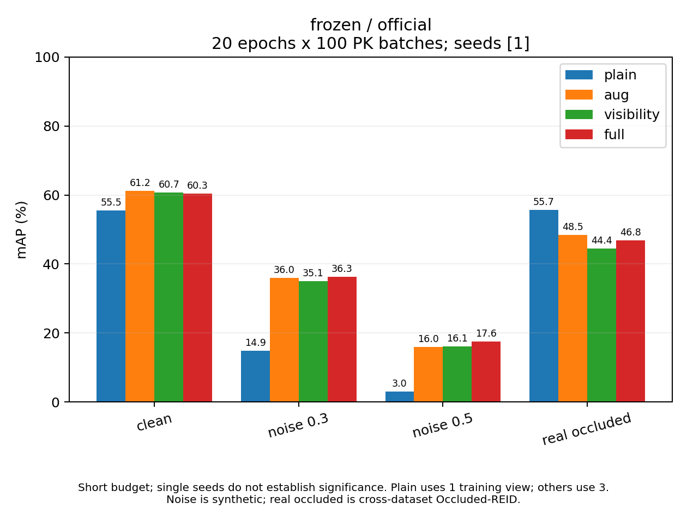

# 轻量化遮挡行人 ReID：OSNet + CLCP

面向本机 RTX 4060 的研究原型。方向选择、文献比较、候选创新与实际实验均保存在本仓库。按用户要求，本机实验只做有限预算的模块对比，不要求完全收敛；实验结论以原始记录为准。

本轮已完成开发消融、四组冻结对照及真实遮挡评测。**当前真实 Occluded-REID 上，plain OSNet 最好；新增方法没有获得真实遮挡优势。** 12 项单元测试与四组实验档案一致性验证通过。

- [研究方案与文献依据](research/研究方案.md)
- [创新与复用来源清单](research/创新来源清单.md)
- [本轮交付清单与文件入口](research/交付清单.md)
- [OSNet baseline 与当前模型网络结构图谱](research/architecture/网络结构图谱.html)
- [实验记录](research/实验记录.md)
- [下一步研究决策](research/下一步研究决策.md)
- [Baseline 来源和固定版本](research/baseline_source.json)
- [环境快照](research/environment.json) / [论文索引](research/literature_index.json)
- [核心参考文献 BibTeX](research/references.bib)

## 方法与 baseline

官方 [deep-person-reid / OSNet](https://github.com/KaiyangZhou/deep-person-reid) 已通过 Git 克隆并以普通源码文件保存在 `code/deep-person-reid`，固定版本 `f8cd150fdf77e8d9e1ed143b7f308c2c609ded50`，保留 MIT LICENSE。上游源码没有改动；`code/reid/model.py` 继承官方 OSNet，使用其 ImageNet 初始化。当前训练引擎适配 Windows 与已有包，不等同于复现原论文的完整训练配方或指标。

CLCP 保持目标图像及遮挡位置不变，更换遮挡外观，测量空间特征漂移；用几何可见度乘以漂移衰减生成停止梯度的可靠性目标。完整变体进一步用相同剩余证据重池化干净教师及遮挡特征。推理只需一个 OSNet、一个小头和 512 维向量，不依赖解析器、姿态模型或 CLIP。

| `--variant` | 训练图像 | 可靠性目标 | 剩余证据一致性 |
|---|---|---|---|
| `plain` | 原图 | 无，官方平均池化 | 无 |
| `aug` | 原图 + 两个遮挡视图 | 无，平均池化 | 无 |
| `visibility` | 同上 | 几何可见度 | 无 |
| `clcp` | 同上 | 几何可见度 × 外观稳定性 | 无 |
| `full` | 同上 | 同上 | 有 |

`plain` 的训练计算量更小。判断模块贡献时，应优先比较相同三视图预算的 `aug/visibility/clcp/full`。

## 已完成的短预算结果

Market 全部训练身份，固定 20 轮 × 100 PK 批次、seed=1、最终轮评测。真实 Occluded-REID 为跨数据集评测，不参与训练或选参；噪声两列仅为合成压力测试。所有数值为百分制。

| 变体 | Market clean mAP | 30% 噪声 mAP | 50% 噪声 mAP | 真实 Occluded mAP / R1 |
|---|---|---|---|---|
| plain | 55.53 | 14.93 | 2.99 | **55.73 / 62.10** |
| aug | **61.18** | 36.01 | 16.04 | 48.50 / 54.80 |
| visibility | 60.65 | 35.10 | 16.11 | 44.41 / 50.00 |
| full | 60.34 | **36.34** | **17.58** | 46.85 / 52.00 |

full 相对 aug 在 50% 合成噪声 mAP 上提高 1.54 点，真实 mAP 却低 1.66 点；相对 plain 的真实 mAP 低 8.88 点。plain 与三视图组训练计算不同，不能把差异全部归因于某一个模块。当前应先检查合成增强的域差异和可靠性目标，不能据此宣称方法有效或达到投稿水平。

开发消融在训练身份内留出验证，统一 8×80 批次，覆盖 aug/visibility/clcp/full。完整指标、失败配方和诊断见 [实验记录](research/实验记录.md)、[正式结果表](results/official_summary/table.md) 和 [验证报告](research/verification.json)。



## 环境

用户确认使用已有 **`mmi-unet`** 环境。Python 3.10.15，PyTorch 2.5.0 / CUDA 12.1，torchvision 0.20.0，RTX 4060 Laptop 8GB。没有更新或重装现有包；完整包快照见 `research/environment-pip-freeze.txt`。本机解释器为 `D:\pytorch\Anaconda3\envs\mmi-unet\python.exe`。

以下命令在仓库根目录执行，先激活环境：

```powershell
conda activate mmi-unet
python tools/record_environment.py
python -m unittest discover -s code/tests -v
```

新引擎直接加载官方 `osnet.py`，不导入上游可选的 timm、gdown、scipy 等包；不要为了本项目直接执行整个上游 requirements 安装。`code/requirements-research.txt` 记录本次使用的最小包版本。

## 数据和 ImageNet 权重

本地已下载、校验并解压；大文件不进 Git。新机器运行：

```powershell
python tools/download_assets.py imagenet
python tools/download_assets.py market
python tools/download_occluded.py
```

下载慢时可用支持断点的分块下载，然后运行对应校验/解压命令：

```powershell
python tools/parallel_download.py market --workers 8
python tools/download_assets.py market
```

来源、固定 revision、SHA256 见 `research/asset_*.json`。只使用 **ImageNet 预训练**，不使用在 Market 或混合 ReID 集训练的现成权重；已重新下载作者 Google Drive 原件，确认与所用镜像权重 SHA256 完全相同，见 `research/primary_source_checks.json`。Occluded-REID 使用作者公开的学术用途数据，不随仓库分发。

```text
data/Market-1501-v15.09.15/{bounding_box_train,query,bounding_box_test}/
data/occluded_body_images/<id>/*.tif
data/whole_body_images/<id>/*.tif
weights/osnet_x1_0_imagenet.pth
```

## 训练与评测

开发协议只使用 Market 训练集，固定留出 100 个身份；其余 651 个身份训练。合成条带噪声是独立的压力测试，不能当作真实遮挡数据结果。

```powershell
python tools/run_suite.py --protocol dev --epochs 8 --steps 80 --tag replica_dev --variants aug visibility clcp full --workers 0
```

正式协议用全部 751 个 Market 训练身份，仅固定最终轮次评测官方测试集。`--external` 另外评测真实 Occluded-REID：200 个身份、1000 张遮挡 query 对 1000 张完整 gallery，不使用该域选参。所有评测均无 reranking、无测试时翻转集成。

```powershell
python tools/run_suite.py --protocol official --epochs 20 --steps 100 --tag replica_official --variants aug full visibility plain --workers 0 --external
```

这是有限预算实验；`--steps 0` 表示每个 epoch 采样 `floor(N/batch_size)` 个 PK batch，不保证每张图恰好访问一次。完整训练建议另起 tag 增加 epoch 与种子，不能把短训练成绩与论文充分收敛结果直接排名。

本次已发布档案的 tag 是 `calibrated` 和 `frozen`；上面复跑命令使用新 tag 以保留原始记录。`run_suite.py` 顺序使用 GPU，本机已有相同 run 的已完成训练会跳过，未完成训练会从末轮 checkpoint 恢复；如果只有已归档结果而缺少对应本机 run，则要求使用新 tag，防止向原日志追加一次新实验。更换配方也必须使用新 tag。手动恢复时保持训练参数不变：

```powershell
python code/train.py --variant full --protocol dev --epochs 8 --steps 80 --workers 0 --output runs/my_full --resume runs/my_full/last.pt
python code/evaluate.py --checkpoint runs/frozen_official_full_s1/last.pt --output results/frozen_official_full_s1/occluded_reid.json --workers 0
```

Checkpoint 包含模型、优化器、AMP scaler 和随机数状态，只保存在被忽略的 `runs/`。配置、逐轮记录、最终结果及原始训练日志进入 `results/`。配置记录源码 SHA256；设置随机种子，但 cuDNN benchmark 允许非确定性内核，不承诺跨设备逐位一致。

## 机制诊断与速度

在开发 checkpoint 上诊断替换遮挡物造成的矩形外漂移；训练结束、GPU 空闲时单独测推理时延：

```powershell
python code/diagnose.py --checkpoint runs/calibrated_dev_aug_s1/last.pt --output results/diagnostic_aug
python code/profile_model.py --output results/profile_4060.json
python tools/summarize_results.py --tags calibrated frozen
python tools/verify_results.py
```

推理计时采用 AMP FP16、256×128 输入，排除图片读取和检索排序；不能当成端到端服务时延。文献工具使用带 pypdf/pypdfium2 的独立文档 Python 环境，不需要把这些依赖装进训练环境。

`verify_results.py` 在冻结的四组实验全部完成后核对源码哈希、相同训练配置、逐轮更新日志、身份划分和评测数量，将结果保存到 `research/verification.json`。它核对实验记录的一致性，不判断方法是否有效。`results/unit_tests.log` 记录训练和损失实现的单元验证。

## 投稿前仍需完成

候选创新未经过穷尽新颖性检索，不能保证录用。需要充分收敛的多种子结果、现代遮挡方法的公平对照、额外骨干/数据集、超参数敏感性及误例分析。具体贡献来源和负结果必须一并披露；目标会议的最新 CCF 分类和截稿时间需要核对学校认可名单。
