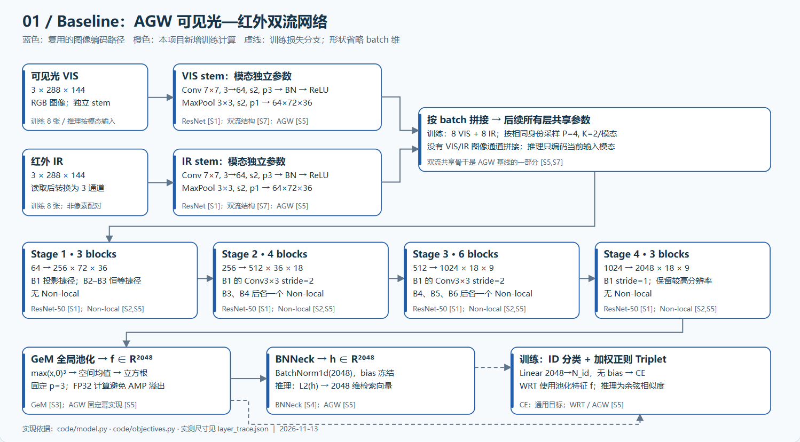
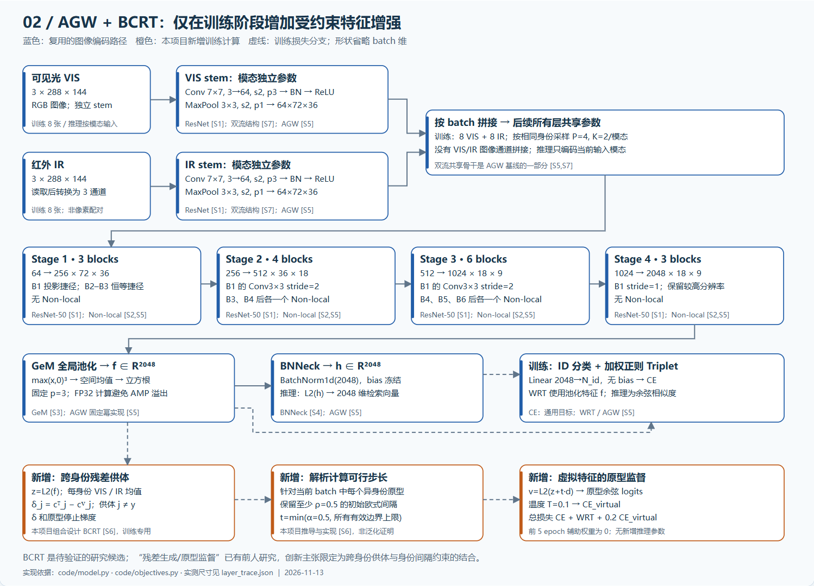

# 可见光-红外行人重识别研究原型

研究方向：监督式可见光-红外行人重识别（VI-ReID），研究**跨身份模态残差迁移的身份边界约束**。Baseline 是 AGW 双流 ResNet-50；候选 BCRT 在训练时从 batch 中其他身份取得模态残差，并解析限制合成步长，使移动后的特征仍保留与固定身份原型间隔的指定比例。BCRT 不添加测试时模块。

目前将 BCRT 作为待检验研究假设，而非已经证明的新颖方法或性能提升。RegDB trial 1 官方测试身份上的短预算实测（20 epochs × 40 steps）中，BCRT 双向平均 Rank-1/mAP 为 49.32/42.41%，AGW 为 44.71/38.23%，center 和无约束对照各为 43.83/38.38% 与 43.16/38.16%。SYSU 同一短预算下，AGW、center、无约束、BCRT 的 all-search Rank-1/mAP 为 5.08/6.36%、6.87/7.96%、6.48/7.80%、6.67/8.09%；室内为 7.15/13.78%、9.09/16.21%、8.74/15.76%、7.02/14.11%。详见[短预算审计摘要](results/official_pilot_v1_summary.md)。这次只跑一个 split/seed；SYSU 十次随机 gallery 是评测采样，不是十次独立训练。RegDB 第 20 轮 BCRT 仅约 0.05%、SYSU 约 1.83% 的候选步长被截断，说明该边界约束多数时候没有改变默认步长。当前不能据此认定性能收益由 BCRT 带来，也不能当作完整复现。

## 网络图

[交互式整网图谱](research/architecture/network.html) 同时展示 baseline、BCRT 训练分支、Non-local、Bottleneck、公式演示、出处，以及逐个卷积展开的 16 个 Bottleneck 图。每个卷积均标注核大小、stride、padding、通道和张量尺寸。





更大图： [Bottleneck 卷积块](research/architecture/bottleneck.png)、[Non-local 运算](research/architecture/nonlocal.png)、[BCRT 计算流程](research/architecture/transport.png)。

## Baseline、代码和来源

AGW 源码固定为 [mangye16/Cross-Modal-Re-ID-baseline](https://github.com/mangye16/Cross-Modal-Re-ID-baseline)，commit `e817a2672c1e14e8802617acb980a79520ef9545`。完整 Git clone 位于本地 `code/upstream/agw`（按仓库 ignore 规则不嵌套推送），经过整理的 MIT 授权上游活动代码在 `code/vendor/agw`，本项目训练入口使用 `code/model.py`。`code/model.py` 与活动上游层做了数值等价测试。AGW 的非局部块按原代码保留 `inter_channels=1`。

引用 ResNet-50/Bottleneck、Non-local、GeM、BNNeck、AGW/WRT、双流结构的论文出处和年份见 [图谱出处表](research/architecture/network.html#sources) 与 [研究方案](research/研究方案与论文依据.md)。本项目独立提出的候选计算见 [创新来源与推导](research/创新来源与推导.md)；不将既有原型、特征合成或普通中心损失冒充原创。

## 数据与环境

用户提供的 RegDB、SYSU-MM01 压缩包已经解压到 `data/regdb_archive/RegDB` 和 `data/sysu_archive`。`data/`、`weights/`、`runs/` 和原压缩包均不会提交。CRC 与压缩包 SHA256 见 `research/dataset_archives.json`；官方 split 身份互斥和全图片解码记录见 `research/data_audit.json`。RegDB train/test 文件的索引标签各自重新从 0 开始，因此读取器按图像原始身份目录核验标签空间，避免身份泄漏。

训练使用已安装的 `mmi-unet` 环境：Python 3.10.15、PyTorch 2.5.0、CUDA 12.1、torchvision 0.20.0、RTX 4060 Laptop 8GB；本项目未改变现有包。ImageNet ResNet-50 初始化权重来自 PyTorch 官方 URL，文件大小 102,502,400 bytes，完整 SHA256 `19c8e3572231adff6824a2da93fd67b5986919a2e65f8b6007eab4edee220097`。它只包含 ImageNet 预训练，不包含 ReID 身份训练。

```powershell
conda activate mmi-unet
python tools/prepare.py --no-download
python tools/audit_data.py
python -m unittest discover -s code/tests -v
python tools/run_suite.py --dataset regdb --data data/regdb_archive/RegDB --protocol official --tag regdb_trial1 --epochs 20 --steps 40 --lr 0.02
python tools/run_suite.py --dataset sysu --data data/sysu_archive --protocol official --tag sysu --epochs 20 --steps 40 --lr 0.02
```

四组实验固定初始化、采样图片预算和 epoch：`agw` (CE+WRT)，`center` (额外均值中心 L2)，`unbounded` (供体残差虚拟特征 CE、固定步长)，`bcrt` (同一目标与掩码、解析受约束步长)。正式 RegDB 每个 trial 独立训练；本轮运行只覆盖 trial 1。SYSU 训练一次，官方 all/indoor 单张随机 gallery 评估十次。训练中不看测试集、不选 best checkpoint，只评估固定最终 epoch。实验档案的配置、完整 20 轮 history、指标及源文件哈希可用 `python tools/summarize_results.py` 一次性核验并生成表格。

每条正式运行命令会在 `runs/` 保存可续训 checkpoint，在 `results/` 保存不可变配置、逐 epoch 诊断和最终指标。预实验见 `results/pilot_v1_regdb_dev_*/`；其训练身份与开发验证身份按身份完全分离。预实验不使用 RegDB 官方测试身份，也不等同于官方 trial。

## 阅读与研究判断

- [研究方案与论文依据](research/研究方案与论文依据.md)：具体问题、baseline、研究假设和评价设计。
- [创新来源与推导](research/创新来源与推导.md)：逐项标注复用论文内容、常规对照、自行组合设计与理论边界。
- [近一年 VI-ReID 进展](research/研究现状与指标对比.md)：CVPR 2026 三项相关工作的论文表格结果，以及不同任务/评测协议的区分。
- [实验记录](research/实验记录.md)：本地真实训练与评测值；未收敛或不支持创新的结果会直接说明。
- [四组官方短预算审计](results/official_pilot_v1_summary.md)：指标表、运行完整性及实际源码/checkpoint 哈希核验。
- [baseline 源码来源](research/baseline_source.json)、[环境快照](research/environment.json)、[引用索引](research/reading_index.json)。

论文是否采用 BCRT，取决于正式多 trial/多 seed 结果、对比与消融、适用协议下的显著性，以及更大范围的相关工作核查。短预算原型数值不能作为投稿结论。
