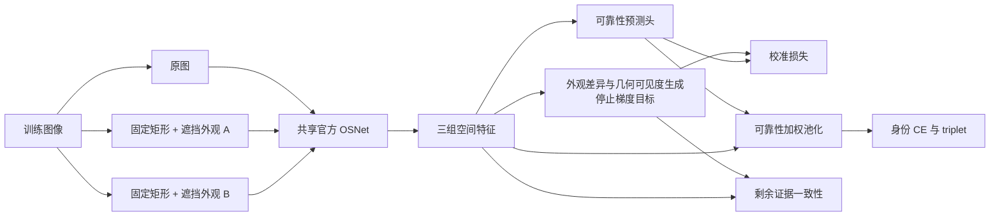

# 研究方向、文献依据与可检验假设

> **阶段说明（2026-11-14 更新）：本文正文保留为 v1 历史记录。** 当前主线仍为遮挡 ReID；本阶段新增跨源图身份支持监督，并执行六变体、两种子的 v2 对照。当前方法见 [第二阶段方法与来源](第二阶段方法与来源.md)，实测正负结果见 [第二阶段实验报告](第二阶段实验报告.md)，新网络图见 [第二阶段网络图](architecture/第二阶段网络图.html)。正文中的“本轮”“尚未追加”“下一次”指 v1 当时状态，不代表 v2 状态。旧实验数字与原始档案保留。

更新日期：2026-11-14。本文是研究实施记录，不代表已经达到录用标准。

## 1. 已确定的研究方向

论文方向已确定为 **遮挡行人重识别**，重点研究合成遮挡外观变化引起的空间特征污染，以及训练期监督能否泛化到真实遮挡。候选题目：

> 面向真实遮挡泛化的受控干预可靠性学习
> Controlled-Intervention Reliability Learning for Occluded Person Re-Identification

“Counterfactual”在这里指保持目标图像和遮挡位置不变、替换遮挡外观的受控合成实验，不能据此宣称完成了真实世界的因果识别。

| 方向 | 本机开展实验的条件 | 主要风险 | 取舍 |
|---|---|---|---|
| 可见光–红外多模态 | 需 SYSU-MM01/RegDB、模态采样及多种评测协议 | 模态差异与遮挡同时引入，归因困难；新遮挡协议还需复现 | 暂不作为第一篇主线 |
| 普通闭集 RGB ReID | OSNet、Market 很容易启动 | 仅加注意力或堆模块难形成有说服力的研究问题 | 作为基本能力评测 |
| 遮挡 ReID | Market 训练 + Occluded-REID 跨数据集评测可实现 | 合成遮挡与真实遮挡有域差异；现有候选尚未改善真实遮挡结果 | **选定主线** |
| 模型轻量化 | 可测参数、计算量和设备延迟 | 需要独立的效率问题、压缩基线和公平速度评测；会分散当前遮挡机制研究 | 不作为论文方向或贡献；OSNet 仅为现有 baseline |
| 换衣、文本/图像检索、终身学习 | 各有针对性数据和协议 | 需更多额外模型或多阶段训练；现有准备较少 | 后续扩展 |
| 云边协同 | 清单 R0186 提供系统层切入点 | 本机单 GPU 不足以验证真实多设备通信收益 | 不作为当前论文主体 |

## 2. 实际阅读范围

原始清单有 653 条，找到 352 个 PDF，另有 301 条缺少本地 PDF。`literature_index.json` 保存了可用文件的元数据与抽取范围；一般文献只抽取前两页用于筛选，16 篇相关文献抽取全文并重点阅读摘要、方法和实验协议。最初 3 个文件的 Unicode 提取错误已经修复，补读其中的 ProFD；针对外部查重线索又核查了 VersReID。**不能把索引数量表述为精读数量，也不能声称读过缺失 PDF。** 元数据中的 `*_listed` 是原清单信息，未全部做 DOI/出版商核验。

补充阅读 OSNet 原论文及 CAL。重点文献及与本项目的关系如下：

| 编号/论文 | 已核查的核心方法 | 对本项目的约束或启发 |
|---|---|---|
| OSNet, ICCV 2019 | 多尺度卷积和统一聚合门控 | 直接复用官方骨干；骨干不是原创，也不把其轻量属性作为论文贡献 |
| CAL, ICCV 2021 | 固定特征、替换注意力，优化事实与反事实分类输出之差 | “反事实注意力”概念已经存在；本项目改变输入遮挡外观并测量空间特征稳定性，不能声称首创反事实 ReID |
| R0353 ADP, AAAI 2024 | 对抗式注意力干扰遮挡、双路径约束 | 普通双视图、干净到遮挡监督不算新；本项目没有复制 ADM/DPC |
| R0354 SPT, AAAI 2024 | 显著性引导的前景/背景 patch 转移、OIoU 和 mask rolling | patch 粘贴早已有之；本项目粘贴只用于构造受控干预 |
| R0356 FPC, AAAI 2024 | token 剪枝、图库近邻匹配、特征补全 | 本项目不做图库补全；统一 512 维特征使检索代价可控 |
| R0454 Feature Completion Transformer | 遮挡特征补全路线 | 用来界定“恢复缺失信息”与“使用剩余证据”的研究差异 |
| R0052 COPE, 清单标为 CVPR 2026 | 不同身份共享同一遮挡物；CLIP 提示背景填充、可靠性评分 | 与本项目的干预轴相反：本项目同一目标/同一位置换遮挡物；未引入 COPE 的任何代码模块 |
| R0624 RGANet, TIFS 2024 | CLIP 区域生成，判别性分数与记忆库区域不变性分数 | “可靠性加权”不新；本项目分数来自同图受控替换，不用区域记忆库 |
| R0369 ProFD, ACM MM 2024 | 文本部位提示与 PifPaf mask 对齐、混合注意力、可见性分类和全局/局部记忆库蒸馏 | 可见性预测及蒸馏已有；本项目不用部位分类标签、CLIP 或部位距离匹配，监督来源是同图受控替换的空间特征差异 |
| R0513 FLaN-Net, 清单标为 IJCAI 2025 | 细粒度语言提示、跨注意力、可靠性融合 | 语言辅助可有效但更复杂；本项目不依赖文本分支 |
| R0574 DPEFormer, 清单标为 KBS 2025 | 代理 token 引导选择、特征融合、SAM 真实遮挡增强 | 选择 token 和真实遮挡生成均已有研究；本项目目前只是矩形合成干预 |
| R0576 SSSC-TransReID | 随机矩形 mask + 无负样本自监督分支 | 不能把“遮挡增强+一致性损失”笼统包装为创新 |
| R0593 PAB-ReID, 清单标为 IJCNN 2024 | 人体解析标签、部位注意力、part triplet | 可作为现代相关方法，但不在当前实现中复制解析模块 |
| R0594 OFOH | CNN/Transformer 集成、MAE、正交融合 | 当前研究关注遮挡监督机制；该集成路线与本文主问题不同 |
| R0032 SFCL | 可见–红外空间频率协同、频率对齐和遮挡基准 | 作为暂不选多模态的证据；未直接搬用频率模块 |
| R0038 TE-VMamba | SSM 专用 token 剪枝与合并 | 算法 FLOPs 与本机运行速度需分别验证 |
| R0186 云边协同 | 时空关联图建模与上传/排序调度 | 与本机特征编码器研究的评价目标不同 |
| R0462 VersReID, TPAMI 2024 | 场景特定提示 ReID Bank、通用提示分支蒸馏、多场景先验增强 | 解决多场景统一模型；本项目没有复制其场景提示或蒸馏过程，集中于单一遮挡机制 |

BPBreID（WACV 2023）已查看官方仓库说明及 Occluded-REID 解析器，尚未运行其训练。它应进入后续现代方法对照；不能把“已看仓库”写成“已复现论文”。

额外通过 OpenAlex 做了 4 组关键词检索，每组仅检查前 5 条线索，记录见 `prior_art_search.json`。检索返回了 CAL、VersReID 等相关工作，也有明显无关结果；这不是穷尽查重，不能以“没有搜到相同标题”证明原创。

## 3. 可检验的研究假设

矩形遮挡的影响不一定限于矩形内部。卷积感受野以及 OSNet 通道门控可能使遮挡物外观影响可见位置的特征。仅用输入像素的二值可见 mask 监督可靠性，会把这些受污染位置误当成干净证据。

H1：固定目标图像和矩形、更换遮挡物后，严格可见区域仍有可测的特征漂移。  
H2：用漂移校准的目标比纯几何可见性监督有更好的遮挡检索效果。  
H3：只对剩余证据施加一致性，比强迫补全全部干净特征更合适。当前实现通过增量消融检验 H3 的一部分，尚缺完整干净教师蒸馏对照。  
H4：在未参与训练和选参的真实遮挡数据上，候选机制能稳定改善遮挡检索；结果需通过独立数据集和多随机种子验证。

H1 成立不意味着 H2 必然成立；头部学习失败、目标漂移、合成到真实域差异均可能导致负结果。所有实验需照实保留。

## 4. 方法定义

对训练样本 x 保留相同矩形 M，选择其他训练身份的两个不同 donor 图像，得到 x_a 和 x_b。共享骨干产生 F_0、F_a、F_b。

几何可见度 `v = AvgPool(1-M)`，每个特征位置的外观敏感度为：

`d_s = max(0, 1 - cosine(F_a[s], F_b[s]))`

拟议的监督目标：

`t_s = stopgrad(v_s * exp(-d_s / tau))`，默认 tau=0.15。

可靠性头为 `512→32 的 1×1 卷积 → GroupNorm/SiLU → depthwise 3×3 → SiLU → 1×1`。输入特征 detach，阻止校准损失直接改写骨干以操纵目标。头部仍接受检索监督经池化传来的梯度。预测 `r=sigmoid(head(stopgrad(F)))`，权重 `w=0.05+0.95r`，池化 `sum(wF)/sum(w)` 后经过官方 OSNet 的 512 维 FC。

`L_cal` 是两个遮挡视图相对于 t 的 BCE。干净视图不被强制监督成全 1，因为原图也有背景和自然遮挡。

完整方案增加剩余证据一致性：用**同一个 t** 分别池化干净教师与两个遮挡视图，教师 detach；计算两个余弦距离的平均，并按每张图的 `mean(t)` 加权、按 batch 权重和归一化。它降低低证据样本的相对权重，**不等于**在全 batch 都低证据时自动缩小损失幅度。

总损失：`L_CE + 0.5 L_triplet + 0.5 L_cal + 0.5 L_evidence`。CE 使用 0.1 label smoothing；triplet 只在每个视图内做 PK batch-hard，避免同一图的增强副本成为虚假的“跨图正例”。

推理只输入单张图像，运行一个骨干和一个可靠性头；没有真实 mask、donor、人体解析、CLIP、近邻补全或教师分支。

## 5. 实验边界与投稿路线

以 `实验记录.md` 和 `results/` 原始记录为准。开发阶段留出 Market 训练集中的 100 个身份；最终正式协议使用全部 751 个训练身份。官方 Market 测试集仅在固定最终轮次评测，Occluded-REID 200 个目标域身份完全不用于训练或选超参数。合成 query 噪声仅是压力测试，不能称为真实 Occluded-REID 结果。

本轮已经完成上述有限预算实验：真实 Occluded-REID 上 plain / aug / visibility / full 的 mAP 分别为55.73 / 48.50 / 44.41 / 46.85。full 的强合成噪声改善没有迁移成真实遮挡优势，当前两项新设计仍是待改进的候选机制。下一步先检验增强的域差异与目标定义，不在本轮追加长训练，也不把负结果省略。

投稿优先考虑与视觉方法匹配的会议；候选会议的当年 CCF 分类与截稿日期尚未独立核实。官方 CCF 页面本次返回验证码，核验状态保存在 `ccf_venue_check.json`。按学校认可的最新名单核对后再确定投稿。

离可投稿论文仍需：充分收敛的公平训练、多随机种子、至少一个现代遮挡对照、额外骨干验证、真实遮挡强度分析、温度/损失权重敏感性、机制图与误例。若只在旧骨干上少量步数得到合成数据提升，不能据此声称 SOTA 或达到 CCF C 录用标准。
