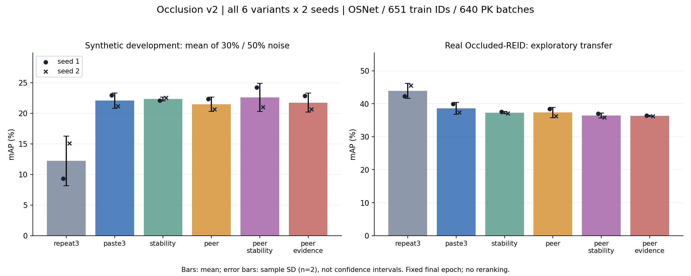
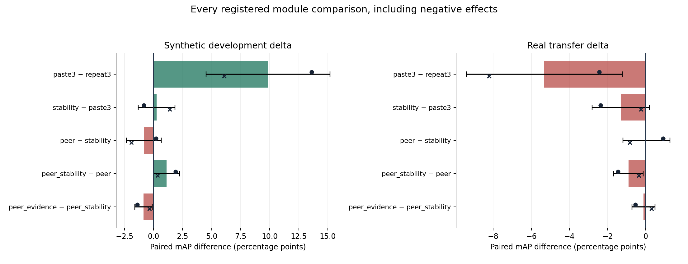

# 遮挡 ReID 第二阶段实验报告

研究方向固定为 **RGB 遮挡行人重识别中的身份证据保留与真实遮挡泛化**。本阶段检验“跨图身份支持能否改进空间可靠性监督”，不研究模型压缩，不把 OSNet 原有的轻量性质当作创新。

本报告对应 `peer_v2`：6 个变体 × 2 个随机种子。完整矩阵、原始小型记录、配对差值及图表见 [结果表](../results/peer_v2_summary/table.md)。设计公式与逐层梯度见 [方法与来源](第二阶段方法与来源.md)，可切换变体的 [网络图](architecture/第二阶段网络图.html) 包含 baseline、6 个 OSBlock、ChannelGate、卷积头和全部采样层。

## 1. 实验问题与来源边界

第一阶段的完整方案未胜过 plain OSNet 的真实遮挡迁移表现，且旧诊断没有支持“矩形外特征漂移被抑制”。本阶段没有直接加大骨干，而是检查旧监督的缺口：**外观稳定的区域也可能没有身份判别价值**。

新候选先用同身份其他源图的 clean 全局特征形成正原型，再与当前批内其他身份原型比较局部余弦 margin。它排除 anchor 源图的全部副本，对重复 peer 源图作倒数加权；两个 donor 视图取较低 margin，经 sigmoid 后乘几何项，作为停止梯度的空间监督。单图推理仍只用 OSNet、可靠性头和加权池化，不调用跨图原型、身份标签、CLIP 或人体解析器。

| 部分 | 归类与出处 | 本阶段实际变化 |
|---|---|---|
| OSNet、OSBlock、ChannelGate、FC | 原样引用；Zhou 等，ICCV 2019；官方 MIT 源码 | 未改骨干；固定上游 commit `f8cd150fdf77e8d9e1ed143b7f308c2c609ded50` |
| 两次矩形 donor 粘贴 | 遮挡增强已有范式；本项目 v1 实现 | 原样沿用；SPT（AAAI 2024）仅是相关工作，未引入其 saliency/OIoU/mask rolling |
| Conv1×1→GN→SiLU→DWConv3×3→SiLU→Conv1×1 头、权重下限与池化 | v1 的通用算子组合 | 原样沿用；不作为第二阶段新网络模块 |
| 外观稳定性 `A` | v1 的双 donor 特征相似度目标 | 原样沿用；联合目标只乘一次几何项 |
| 排除自身源图的身份原型 margin、重复源图去权、双 donor 最低支持目标 `I` | 本阶段自行设计和实现的监督候选 | 这是实际新增代码；不能声称原型、margin、minimum 或 sigmoid 本身新颖 |
| `G·I·A` 联合监督 | 本阶段的组合候选；判别性＋不变性已有 RGANet（TIFS 2024）先例 | 未移植 RGANet 的 CLIP 部位原型或部位 memory bank；需要消融判断是否保留 |
| 剩余证据一致性 | v1 `surviving_evidence_loss` | 原样复用，只替换输入 target；不是另一个原创模块 |

DPM（ACM MM 2022）已经利用原型选择可见判别模式。本项目与它的原型来源、训练目标和推理路径不同，但这些差异**不自动等于学术创新成立**。RGANet 已有判别性与不变性联合思想，TGPG（IEEE SPL 2024）目前仅核对元数据和摘要。全文核查与尚未排除的重合见 [查重记录](原型方法查重记录.md)。本轮不是截至 2026 年的穷尽查新。

## 2. 冻结协议与实际预算

协议在新阶段训练前写入 [occlusion_v2_protocol.json](occlusion_v2_protocol.json)。训练期间没有依据途中分数更改配方，也没有挑选最佳 epoch。全部开发训练结束后，才冻结所有 checkpoint 的 SHA256 清单并统一外测全部 12 组。

| 项目 | 固定设置 |
|---|---|
| 环境 | 现有 `mmi-unet`；Python 3.10.15、PyTorch 2.5.0、torchvision 0.20.0、CUDA 12.1；未替换环境包 |
| GPU | RTX 4060 Laptop，8GB |
| 初始化 | OSNet x1.0 ImageNet 权重；不是已训练的 ReID 权重 |
| 身份划分 | Market 训练身份内部，划分 seed=2026；651 train / 100 development，无身份交集 |
| 图片数量 | 训练 11,360；开发 query 100 / gallery 1,476 |
| 每组训练 | 8 轮 × 80 PK 批；每批 6 身份 × 4 次 draw；3 视图合计 72 张输入；seed=1、2 |
| 稀疏身份 | 12 个训练身份不足 4 图，最少 2 图；先覆盖源图再补采样；六组使用相同采样规则 |
| 优化器 | Adam AMSGrad，基础 lr=0.0003，分类器／可靠性头 ×5，wd=0.0005，cosine，AMP，clip=10 |
| 首两轮 | 冻结骨干与 FC，骨干处于 eval；训练分类器及存在的可靠性头 |
| 检索损失 | label smoothing=0.1 的 CE＋0.5×逐视图 batch-hard triplet；不跨相同源图的三个视图挖正样本 |
| 辅助损失 | 启用时，0.5×校准 BCE；仅 peer_evidence 加 0.5×旧一致性损失 |
| 开发主指标 | `(30% noise mAP + 50% noise mAP)/2`，再对两个种子平均 |
| 合成噪声 | query 的固定宽度水平条带，以噪声覆盖 30%／50% 高度；gallery 不遮挡；与训练 donor 矩形分布不同 |
| 真实外测 | Occluded-REID，200 个身份，全部 1000 遮挡 query 对 1000 完整 gallery；无 reranking／翻转集成／目标域训练 |

六个变体依次为 `repeat3`（同一个常规增强 tensor 复制三份＋GAP）、`paste3`（clean＋双 donor＋GAP）、`stability`（旧头，`G·A`）、`peer`（同头，`G·I`）、`peer_stability`（`G·I·A`）、`peer_evidence`（联合目标＋旧一致性）。`repeat3` 同样消耗 donor 随机序列；它不代表三个独立常规增强。

**640 个 PK 批次并不保证 640 次参数更新。** AMP 溢出跳步由日志逐次记录。协议文本中“640 updates”是预期上限，实际更新以原始逐轮记录及核验表为准。没有为了追齐更新数追加训练。

`peer_evidence / seed=2` 的首次进程在 2026-11-14 23:30:31（UTC+8）发生原生崩溃。Windows Application Event 1000 记录故障模块 `nvcuda64.dll`、异常码 `0xc0000409`；这定位了报错模块，但不证明底层根因。它只输出 start，未保存 epoch 或 checkpoint，实际已执行的部分操作数未知。原始配置、日志和事件字段保存在 [失败记录](../results/failed_attempts/peer_v2_peer_evidence_s2_attempt1/incident.json)。核对源码与协议哈希未变后，用相同 seed 和初始化重新开始该组；此前 11 组结果保留。不是看分数后重选种子或配方。最终资源表仅统计完成运行的 epoch 记录，不包含这次失败启动及模型加载／评测时间。

统一外测进行到 `stability / seed=2` 时，2026-11-14 23:41:37（UTC+8）再次出现相同 DLL 和异常码的原生进程崩溃，未生成该组评测结果。保存 [外测故障记录](../results/failed_attempts/peer_v2_stability_s2_evaluation_attempt1/incident.json) 后，重启未修改的 runner，复用已完成的 12 个训练 checkpoint 和 8 份外测结果，完成余下 4 组；没有重新训练或替换 checkpoint。最后一组外测于当日 23:44:33（UTC+8）完成。两次故障根因均未查明，恢复成功不等于驱动问题已修复。

完成运行共记录 **7,680 个 PK 批次、7,671 次参数更新、9 次 AMP 跳步**；每组实际更新 639 或 640 次。逐轮训练计时合计 **2,639.5 秒（约 44.0 分钟）**，峰值 PyTorch CUDA allocated 为 **3,114.3–3,116.7 MiB**。这不是完整墙钟耗时或整卡显存占用，也不是严格速度基准；加载、评测和失败启动未计入。

## 3. 完整结果与模块结论

**本轮未得到真实遮挡泛化的正向证据，不能把新候选作为已验证的最终论文方法。** 普通 OSNet 对照在两个种子的真实 mAP 中都高于全部增强／可靠性变体；合成开发集的排名没有迁移到真实数据。下表为两种子均值 ± 样本标准差，百分制；完整逐种子数字、Rank-5、mINP、训练诊断和资源记录见 [完整结果表](../results/peer_v2_summary/table.md) 及 [CSV](../results/peer_v2_summary/metrics.csv)。

| 变体 | 实际新增或替换内容 | 合成开发 mAP | 真实 Occluded-REID mAP | 真实 Rank-1 |
|---|---|---:|---:|---:|
| repeat3 | OSNet＋GAP，普通增强 tensor 复制三份 | 12.21 ± 4.07 | **43.94 ± 2.27** | **51.50 ± 2.97** |
| paste3 | 双 donor 矩形遮挡增强 | 22.06 ± 1.26 | 38.62 ± 1.82 | 45.35 ± 2.76 |
| stability | 旧可靠性头＋`G·A` 校准 | 22.34 ± 0.32 | 37.32 ± 0.32 | 43.45 ± 1.34 |
| peer | 同头，目标替换为新 `G·I` | 21.49 ± 1.18 | 37.35 ± 1.55 | 43.25 ± 3.04 |
| peer_stability | 新目标联合旧稳定性 `G·I·A` | **22.62 ± 2.29** | 36.45 ± 0.78 | 43.25 ± 1.63 |
| peer_evidence | 联合目标＋旧剩余证据一致性 | 21.75 ± 1.55 | 36.34 ± 0.18 | 42.85 ± 0.64 |

### 3.1 每个模块的正负结果

下面的差值均为相同 seed 下“左减右”后再取平均，单位为百分点。保留两个种子的方向，防止均值掩盖不一致。

| 比较 | 合成开发：s1 / s2 / 均值 | 真实 mAP：s1 / s2 / 均值 | 本轮判断 |
|---|---|---|---|
| paste3 − repeat3 | +13.62 / +6.08 / **+9.85** | −2.42 / −8.21 / **−5.32** | 增强提高合成噪声鲁棒性，却降低本轮真实迁移；不能把合成提升当作遮挡任务已解决 |
| stability − paste3 | −0.84 / +1.39 / **+0.27** | −2.37 / −0.25 / **−1.31** | 旧头、加权池化和校准组合无稳定开发收益，真实两种子均下降 |
| peer − stability | +0.22 / −1.90 / **−0.84** | +0.91 / −0.83 / **+0.04** | 新身份目标未稳定优于旧目标；真实均值近于零且种子方向相反 |
| peer_stability − peer | +1.91 / +0.33 / **+1.12** | −1.45 / −0.36 / **−0.90** | 联合外观稳定性在两种子合成指标上为正，真实指标两种子均为负 |
| peer_evidence − peer_stability | −1.38 / −0.34 / **−0.86** | −0.54 / +0.31 / **−0.12** | 直接追加旧一致性无保留依据；合成均下降，真实不稳定 |

其中 `peer_stability` 虽为开发均值最高者，相对旧 `stability` 只高约 **0.28** 个百分点；对应真实 mAP 低约 **0.87** 个百分点。不能仅展示联合目标的合成正结果，或仅展示 `peer / seed=1` 的正增益。所有外测均按预先登记的完整矩阵执行，没有利用真实分数重选配方。





### 3.2 当前研究决策与下一步

研究方向继续保持遮挡 ReID；这次失败限制的是当前监督构造及短预算配方，不能推广成“原型机制均无效”或“遮挡方向不值得研究”。当前 `peer` 系列保留为完整研究候选与负结果档案，**不将 `peer_evidence` 或联合目标定为最终投稿模型，不宣称 SOTA 或有效新贡献**。

下一阶段应先解决最明显的矛盾：仅加矩形 donor 已使真实 mAP 下降 5.32 个百分点。在新的预注册实验中，优先控制遮挡增强分布与强度、独立常规增强视图，并加入纯几何 target／只加头等对照；再检查局部—全局原型错配和 minimum 是否过度抑制有效线索。上述是待验证假设，本轮没有执行这些实验。当前结果不足以判断新目标在充分训练下的表现。

若继续形成论文方案，还需在适当授权的遮挡训练／验证协议中充分训练，引入现代遮挡方法的公平基线，并留出未用于设计的新确认数据。不能继续对已反复查看的 Occluded-REID 分数调参，再将其包装成独立盲测。后续实验另用新 tag、新协议；本轮档案保持冻结。

## 4. 诊断能说明什么

训练日志记录末轮 target 均值、身份支持均值、双 donor 最低 margin 均值、校准 MAE 和辅助损失。它们是训练中的生成目标诊断，**没有独立的人体可见性／部位真值**。不同变体的 target 语义不同，不能把较小 MAE 直接解释成检索更好。无对应模块时记录的 0 是占位。

身份支持与 margin 的全图平均包含矩形覆盖区、人体和背景。均值负数不能单独证明人体区域全部无判别性；均值正数也不能证明消除了背景。共享背景、局部—全局语义错配、仅有五个批内负身份以及短训练原型不充分，都是待验证的解释，不能写成已证机制。

头部输入虽 `detach`，检索损失仍通过池化权重训练头，校准 BCE 不是唯一监督。相同 target 下重新池化的 clean 教师也只来自当前骨干，不是独立强教师。现有日志不支持“无信息损失”“概率完全校准”或“真正分离遮挡物”等结论。

## 5. 研究结论的适用范围

1. 两个种子的误差条是**样本标准差，不是置信区间**；没有显著性检验依据，也没有充分收敛证据。
2. 合成噪声开发结果与真实遮挡结果分别报告；合成提升不能替代真实泛化证据。外测在 v1 已经观察过，只能称探索性迁移评测，不是新的独立盲测。
3. v2 用 651 个训练身份、640 个 PK 批；v1 正式实验是 751 个身份、2000 批。不能横跨两种预算相减后声称模块提高或退化了相应百分点。
4. `stability − paste3` 同时引入了头、池化和校准，是组合差异；只有 `peer − stability` 保持同一头结构并替换监督目标。尚未做随机 target、纯几何 target、只加头、minimum 对比 mean、去除负原型等细化对照。
5. 不将本项目短预算结果与 DPM／RGANet 等充分训练、不同骨干和协议的论文结果直接排序。OSNet 是当前硬件上的实验基线，投稿还需现代遮挡方法公平对照。
6. cuDNN benchmark 允许非确定性内核；复跑不承诺逐位相同。数据记录哈希覆盖路径、身份和相机信息，不覆盖每张图的字节；下载资产 SHA 另见 `asset_*.json`。

## 6. 归档、迁移与复核入口

- [全部原始结果与正负配对差值](../results/peer_v2_summary/table.md)：每个 seed、两种子均值／标准差、末轮诊断、实际更新和资源使用。
- [外测前冻结清单](../results/peer_v2_summary/external_freeze_manifest.json) 与 [v2 核验记录](../results/peer_v2_summary/verification.json)：核对全部矩阵、来源／协议／checkpoint 哈希、时间顺序及日志。
- [21 项实现测试日志](../results/unit_tests_v2.log)：新机制的语义、源图排除、重复去权、停止梯度、采样与反向，以及 v1 回归验证。
- [迁移审计](workspace_migration_audit.json)：旧 Git 树的 230 个代码／结果文件，19 个字节一致、211 个仅 checkout CRLF/LF 差异；不能将此表述为所有文件的原始字节完全一致。
- [旧四组结果核验](v1_post_migration_verification.json) 与 [Git checkout 字节核验](git_checkout_byte_audit.json)：分别确认历史实验一致性和 v2 审计文件可按 `.gitattributes` 还原。
- [历史实验](实验记录.md)：v1 正负结果继续保留；旧路径现在对应 `occluded_reid/` 内同名目录。

三个方向已分目录；`reference-paper/` 共享。数据、PDF、模型权重、checkpoint 和缓存本地保留，不随 Git 提交。上游许可证、代码、结果 JSON／CSV、文本日志和研究说明保留。核验说明记录一致性，不等于确认方法有效。

复核命令在 `E:\论文\occluded_reid`、`mmi-unet` 中执行：

```powershell
python tools/verify_occlusion_v2.py --require-checkpoints
python tools/summarize_occlusion_v2.py
```

新机器未取得大权重时可省略 `--require-checkpoints`，但只验证已发布的小型档案；要重新训练请使用新 tag，例如 `python tools/run_occlusion_v2.py --tag replica_v2`。不要覆盖 `peer_v2` 的冻结结果。
