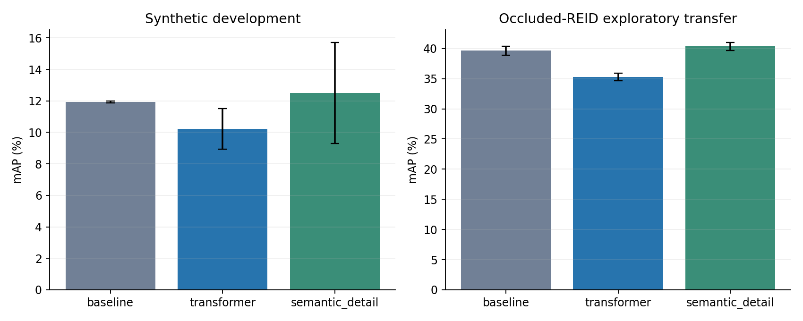

# 第三阶段结构消融结果

百分制，两种子均值 ± 样本标准差；误差不是置信区间。合成开发指标为 30%/50% 横向遮挡 mAP 的均值。

| 模型 | seed | clean mAP | noise30 | noise50 | 开发遮挡均值 | 真实 mAP | 真实 R1 | 参数量 | 更新 / 跳步 |
|---|---:|---:|---:|---:|---:|---:|---:|---:|---:|
| baseline | 1 | 55.12 | 18.51 | 5.28 | 11.89 | 40.14 | 47.20 | 2,169,508 | 639 / 1 |
| baseline | 2 | 55.96 | 18.48 | 5.49 | 11.98 | 39.13 | 46.20 | 2,169,508 | 640 / 0 |
| transformer | 1 | 55.83 | 17.24 | 5.03 | 11.13 | 34.81 | 41.00 | 4,338,852 | 640 / 0 |
| transformer | 2 | 57.99 | 14.38 | 4.26 | 9.32 | 35.71 | 41.80 | 4,338,852 | 640 / 0 |
| semantic_detail | 1 | 54.74 | 16.53 | 3.95 | 10.24 | 39.86 | 47.30 | 2,432,678 | 640 / 0 |
| semantic_detail | 2 | 57.60 | 21.88 | 7.68 | 14.78 | 40.82 | 49.70 | 2,432,678 | 640 / 0 |

## 两种子均值 ± 样本标准差

| 模型 | 开发遮挡 mAP | 真实 mAP | 真实 Rank-1 | 训练秒数 | 峰值 CUDA MiB |
|---|---:|---:|---:|---:|---:|
| baseline | 11.94 ± 0.06 | 39.64 ± 0.72 | 46.70 ± 0.71 | 174.80 ± 43.49 | 1076.15 ± 0.00 |
| transformer | 10.23 ± 1.28 | 35.26 ± 0.64 | 41.40 ± 0.57 | 112.63 ± 0.11 | 1130.42 ± 0.00 |
| semantic_detail | 12.51 ± 3.21 | 40.34 ± 0.68 | 48.50 ± 1.70 | 109.00 ± 0.73 | 1082.53 ± 0.00 |

## 配对结构差值

| 比较 | 指标 | s1 | s2 | 平均差 |
|---|---|---:|---:|---:|
| transformer - baseline | development_map | -0.76 | -2.66 | -1.71 |
| transformer - baseline | external_map | -5.33 | -3.42 | -4.38 |
| transformer - baseline | external_rank1 | -6.20 | -4.40 | -5.30 |
| semantic_detail - baseline | development_map | -1.65 | +2.80 | +0.57 |
| semantic_detail - baseline | external_map | -0.29 | +1.69 | +0.70 |
| semantic_detail - baseline | external_rank1 | +0.10 | +3.50 | +1.80 |
| semantic_detail - transformer | development_map | -0.89 | +5.46 | +2.28 |
| semantic_detail - transformer | external_map | +5.04 | +5.11 | +5.08 |
| semantic_detail - transformer | external_rank1 | +6.30 | +7.90 | +7.10 |

真实集已在前两阶段查看，本表是探索性迁移。保留所有种子与负结果；逐轮记录和 checkpoint/source/data-record 哈希见各运行 JSON、freeze manifest 与 verification.json。
