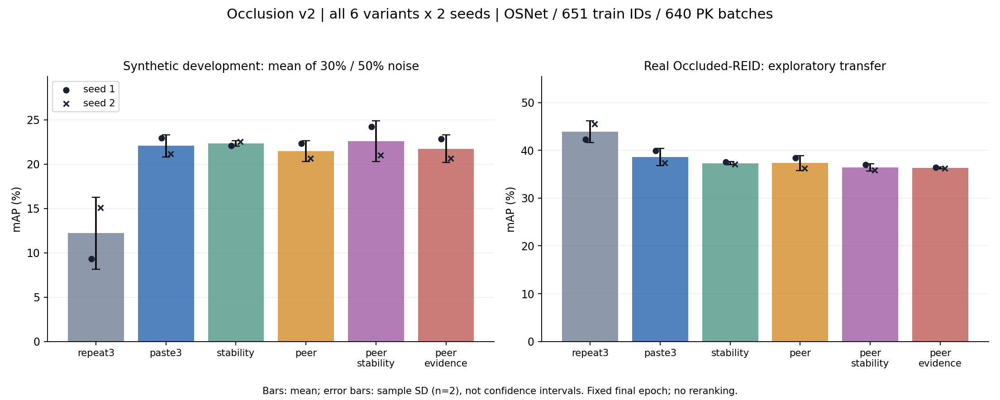
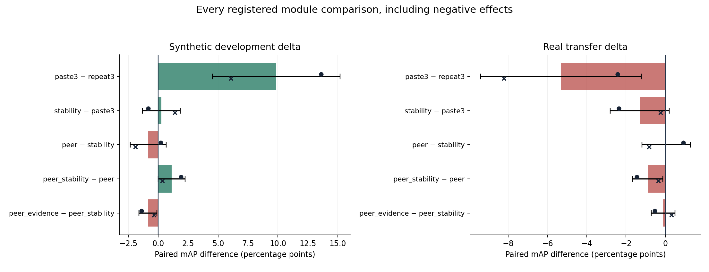

# 第二阶段完整结果（自动从冻结档案生成）

数值单位为百分制；差值为百分点。开发遮挡均值 = (30% + 50% 合成噪声 mAP)/2。

## 每个种子的原始结果

| 变体 | seed | clean mAP | noise30 | noise50 | 开发遮挡均值 | 真实 mAP | 真实 R1 | 实际更新 / 批次 | AMP跳步 |
|---|---:|---:|---:|---:|---:|---:|---:|---:|---:|
| repeat3 | 1 | 54.74 | 14.45 | 4.22 | 9.33 | 42.33 | 49.40 | 639/640 | 1 |
| repeat3 | 2 | 54.96 | 21.84 | 8.35 | 15.09 | 45.55 | 53.60 | 639/640 | 1 |
| paste3 | 1 | 56.57 | 31.98 | 13.93 | 22.95 | 39.91 | 47.30 | 639/640 | 1 |
| paste3 | 2 | 55.85 | 30.78 | 11.56 | 21.17 | 37.34 | 43.40 | 639/640 | 1 |
| stability | 1 | 52.40 | 30.17 | 14.05 | 22.11 | 37.54 | 44.40 | 639/640 | 1 |
| stability | 2 | 52.75 | 31.98 | 13.14 | 22.56 | 37.09 | 42.50 | 639/640 | 1 |
| peer | 1 | 53.25 | 31.50 | 13.15 | 22.33 | 38.45 | 45.40 | 640/640 | 0 |
| peer | 2 | 53.66 | 30.48 | 10.84 | 20.66 | 36.26 | 41.10 | 639/640 | 1 |
| peer_stability | 1 | 51.41 | 31.61 | 16.86 | 24.24 | 37.00 | 44.40 | 640/640 | 0 |
| peer_stability | 2 | 52.28 | 30.36 | 11.63 | 20.99 | 35.90 | 42.10 | 639/640 | 1 |
| peer_evidence | 1 | 53.12 | 30.88 | 14.83 | 22.85 | 36.46 | 42.40 | 640/640 | 0 |
| peer_evidence | 2 | 53.15 | 30.53 | 10.78 | 20.65 | 36.21 | 43.30 | 639/640 | 1 |

## 两种子均值 ± 样本标准差

误差是两个种子的样本标准差，不是置信区间。

| 变体 | clean mAP | noise30 | noise50 | 开发遮挡均值 | 真实 mAP | 真实 R1 |
|---|---:|---:|---:|---:|---:|---:|
| repeat3 | 54.85 ± 0.15 | 18.14 ± 5.23 | 6.28 ± 2.91 | 12.21 ± 4.07 | 43.94 ± 2.27 | 51.50 ± 2.97 |
| paste3 | 56.21 ± 0.51 | 31.38 ± 0.84 | 12.75 ± 1.67 | 22.06 ± 1.26 | 38.62 ± 1.82 | 45.35 ± 2.76 |
| stability | 52.58 ± 0.25 | 31.08 ± 1.28 | 13.59 ± 0.64 | 22.34 ± 0.32 | 37.32 ± 0.32 | 43.45 ± 1.34 |
| peer | 53.46 ± 0.29 | 30.99 ± 0.72 | 11.99 ± 1.63 | 21.49 ± 1.18 | 37.35 ± 1.55 | 43.25 ± 3.04 |
| peer_stability | 51.85 ± 0.61 | 30.98 ± 0.89 | 14.25 ± 3.70 | 22.62 ± 2.29 | 36.45 ± 0.78 | 43.25 ± 1.63 |
| peer_evidence | 53.14 ± 0.01 | 30.70 ± 0.25 | 12.80 ± 2.86 | 21.75 ± 1.55 | 36.34 ± 0.18 | 42.85 ± 0.64 |

## 预注册的配对模块差值

| 比较（左减右） | 开发 s1 | 开发 s2 | 开发平均 | 真实 s1 | 真实 s2 | 真实平均 |
|---|---:|---:|---:|---:|---:|---:|
| paste3 − repeat3 | +13.62 | +6.08 | +9.85 | -2.42 | -8.21 | -5.32 |
| stability − paste3 | -0.84 | +1.39 | +0.27 | -2.37 | -0.25 | -1.31 |
| peer − stability | +0.22 | -1.90 | -0.84 | +0.91 | -0.83 | +0.04 |
| peer_stability − peer | +1.91 | +0.33 | +1.12 | -1.45 | -0.36 | -0.90 |
| peer_evidence − peer_stability | -1.38 | -0.34 | -0.86 | -0.54 | +0.31 | -0.12 |

## 末轮训练诊断（不是独立可见性真值评估）

| 变体 / seed | target均值 | 身份支持均值 | margin均值 | 校准MAE | 校准loss | 一致性loss | 训练秒数 | 峰值MiB |
|---|---:|---:|---:|---:|---:|---:|---:|---:|
| repeat3 / 1 | 0.0000 | 0.0000 | 0.0000 | 0.0000 | 0.0000 | 0.0000 | 325.4 | 3115.6 |
| repeat3 / 2 | 0.0000 | 0.0000 | 0.0000 | 0.0000 | 0.0000 | 0.0000 | 244.5 | 3114.3 |
| paste3 / 1 | 0.0000 | 0.0000 | 0.0000 | 0.0000 | 0.0000 | 0.0000 | 199.0 | 3115.6 |
| paste3 / 2 | 0.0000 | 0.0000 | 0.0000 | 0.0000 | 0.0000 | 0.0000 | 198.6 | 3115.6 |
| stability / 1 | 0.3789 | 0.0000 | 0.0000 | 0.2306 | 0.5512 | 0.0000 | 208.6 | 3116.7 |
| stability / 2 | 0.3806 | 0.0000 | 0.0000 | 0.2278 | 0.5487 | 0.0000 | 203.0 | 3116.7 |
| peer / 1 | 0.3222 | 0.4223 | -0.0333 | 0.1491 | 0.5952 | 0.0000 | 209.7 | 3116.7 |
| peer / 2 | 0.3195 | 0.4202 | -0.0342 | 0.1502 | 0.5947 | 0.0000 | 209.4 | 3116.7 |
| peer_stability / 1 | 0.1781 | 0.4237 | -0.0326 | 0.1288 | 0.4419 | 0.0000 | 210.1 | 3116.7 |
| peer_stability / 2 | 0.1778 | 0.4188 | -0.0349 | 0.1264 | 0.4381 | 0.0000 | 209.5 | 3116.7 |
| peer_evidence / 1 | 0.1831 | 0.4224 | -0.0333 | 0.1324 | 0.4498 | 0.0310 | 212.1 | 3116.7 |
| peer_evidence / 2 | 0.1823 | 0.4184 | -0.0352 | 0.1305 | 0.4468 | 0.0333 | 209.6 | 3116.7 |

无对应模块时诊断值为 0 占位，不表示校准完美。不同 target 的 MAE 不代表相同语义任务，不能单凭较小 MAE 判断检索更好。

所有组均为 651-ID / 8×80 批次训练，与 v1 的 751-ID / 20×100 正式组不构成直接模块对照。
全部开发完成后才冻结并外测；旧阶段已观察过此真实数据集，因此只能称探索性跨域确认。
预算、checkpoint/source/data-record 哈希、原始日志和顺序校验见 verification.json 与 external_freeze_manifest.json。
