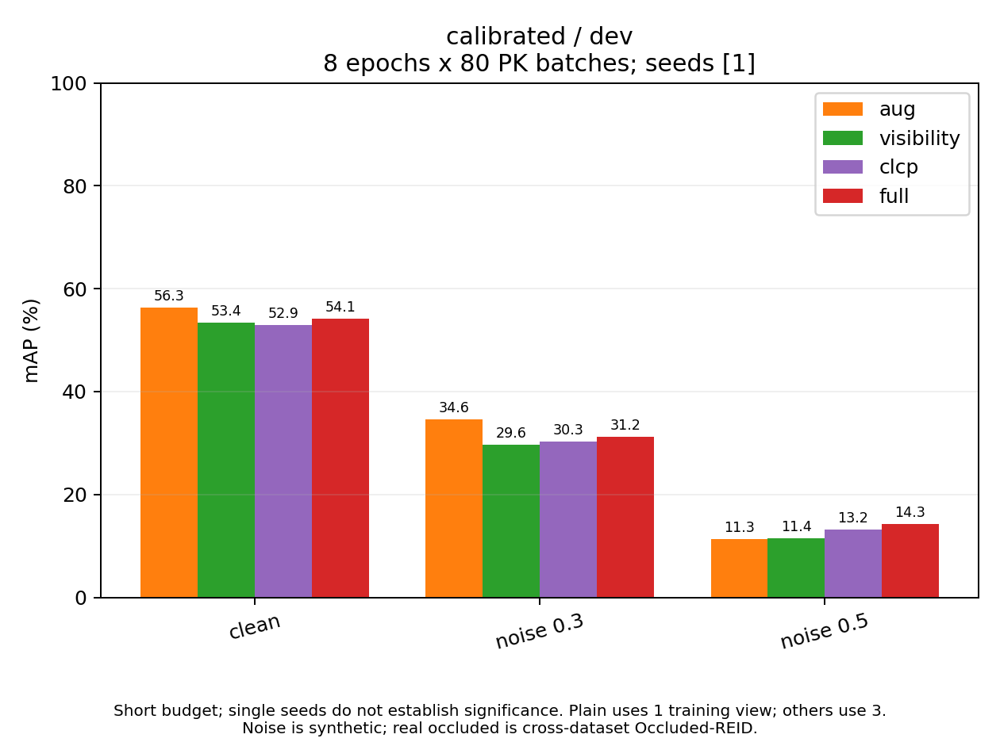
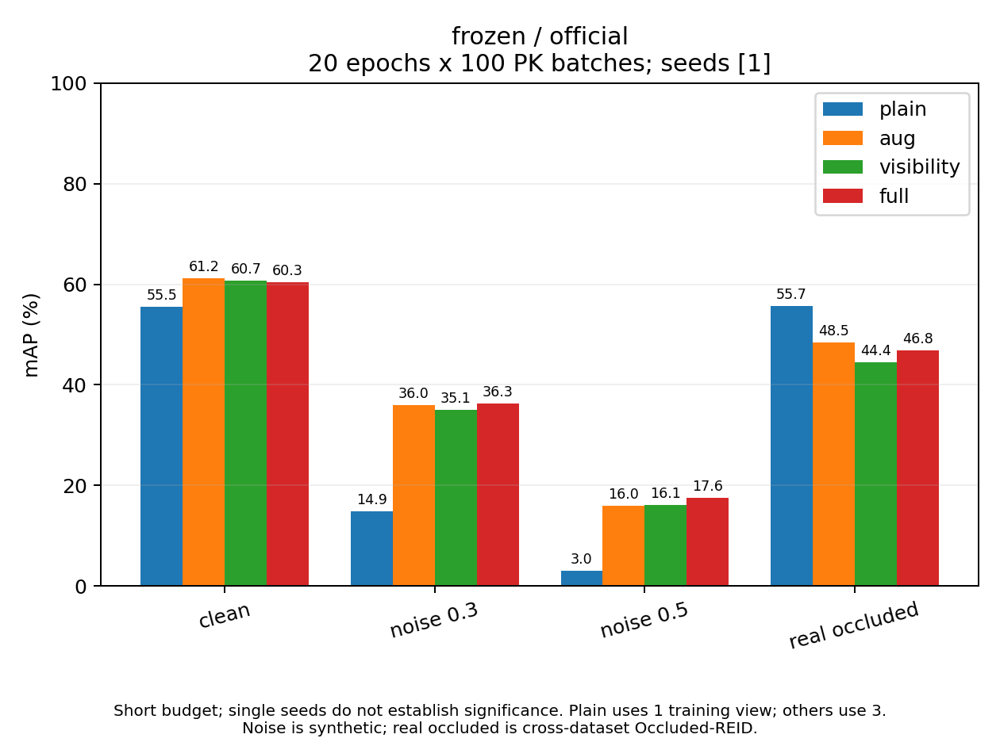

# 实验记录与证据边界

日期：2026-11-13。所有数字采用百分制，差值单位为百分点。小结果进入 Git，训练权重保留在本机 `runs/`。

本机实验按用户补充要求，仅验证模块之间的大致差异，不追求完全收敛。因此本轮完成有限预算对照即可，不把充分收敛、多种子等后续投稿工作当成本轮必须完成的事项。

## 1. 环境、数据与训练预算

- 用户确认的环境为 `mmi-unet`；没有新装或替换包。RTX 4060 Laptop 8GB，PyTorch 2.5.0，CUDA 12.1。
- 初始化只使用 OSNet 的 ImageNet 权重，SHA256 已核验；不是预先在 Market 上训练的 ReID 权重。
- 开发：Market 原训练集 751 个身份中固定留 100 个验证，651 个训练，split seed=2026。训练 11,360 张，验证 query 100 张、gallery 1,476 张。
- 正式：Market 全部 751 个训练身份、12,936 张图；官方 query 3,368 张，gallery 扫描后排除 `pid=-1` junk，剩余 15,913 张。评测继续排除同身份同摄像头匹配。
- 真实遮挡：作者 Occluded-REID 全部 200 个身份；1,000 张遮挡 query 对 1,000 张完整 gallery。Market 训练到该数据的跨数据集评测，没有目标域训练或选参。
- 合成压力测试：query 上填充标准正态噪声的整宽条带，高度比例为 0.3/0.5，gallery 保持原图。它与训练时其他身份 patch 矩形粘贴不同，也与真实遮挡不同，不能用其数字代替 Occluded-REID。
- 不使用 reranking、测试时翻转集成或解析器。随机种子固定但 cuDNN benchmark 开启，不能承诺逐位复现。

## 2. 失败与训练配方修正

初始全网 lr=0.0015、无 classifier-only 预热的 `pilot_dev_aug_s1` 在 8×80 更新后开发 clean mAP 仅 3.91、Rank-1 3.00，CE 接近随机分类。随后 visibility 也不学习，故停止。失败记录及日志完整保留在 `results/pilot_*`，不进入有效消融，详见 `results/failed_recipe_note.md`。

修正后：backbone lr=0.0003，classifier/reliability 倍数5，AMSGrad，weight decay=0.0005，前2轮固定骨干及其BN，后续全网训练，warmup+cosine。CE label smoothing=0.1，加 0.5 normalized-feature batch-hard triplet；按变体加0.5校准和0.5证据损失。

调参确认运行 `recipe_check_dev_aug_s1` 的 clean mAP=56.05，证实训练恢复。它每2轮验证，启动早于评估 RNG 隔离修复，只作配方检查，不能冒充统一消融中的 aug。

该配方与上游150轮、batch64、fixbase10、softmax的完整论文设置不同。即使采用官方架构，也不能把本次成绩称为复现原论文成绩。

## 3. 统一开发消融：8轮 × 80更新，seed=1

| 变体 | Clean mAP / R1 | 30% 噪声 mAP / R1 | 50% 噪声 mAP / R1 | 两档遮挡平均 mAP |
|---|---|---|---|---|
| aug | 56.28 / 71 | 34.62 / 44 | 11.35 / 16 | **22.99** |
| visibility | 53.36 / 69 | 29.63 / 40 | 11.43 / 14 | 20.53 |
| clcp | 52.88 / 74 | 30.31 / 41 | 13.17 / 16 | 21.74 |
| full | 54.12 / 71 | 31.25 / 42 | **14.27 / 22** | 22.76 |

四组使用相同原图与两遮挡视图、相同PK身份及干预随机序列、相同最终轮数。方法差异仍会通过BN与梯度影响后续特征，这是训练的正常组成。

预先记录的主要开发指标是两个遮挡强度的平均 mAP，见 `development_protocol.json`。单独把几何监督改成污染目标（visibility → clcp）提高1.21点；在 clcp 上增加剩余证据一致性（clcp → full）再提高1.02点。full 比几何监督合计高2.23点，但仍比普通增强低0.23点；clean 也低2.16点。只有50%强遮挡指标比 aug 高2.93点。**不能只展示这一有利列并宣称整体提升。** 单种子、100个query不足以支持显著性结论。

选择 full 作为最好的候选新方法，保留 aug 作为更强的开发对照。正式配置在首次查看官方测试/真实遮挡分数之前冻结，记录为 `frozen_protocol.json`。本轮不根据目标域结果再选温度、损失权重、epoch或checkpoint。

## 4. 机制诊断

在开发身份上固定干预采样，192张图、15,250个严格几何可见的特征格点，模型eval模式且不更新BN。比较同一目标、同一矩形、不同遮挡外观的空间特征。

| 指标 | aug | full |
|---|---|---|
| 矩形外余弦漂移均值 | 0.08233 | 0.08716 |
| 漂移中位数 | 0.04671 | 0.05093 |
| 漂移 > 0.05 的可见格点比例 | 47.35% | 50.72% |
| 可见格点校准目标均值 | 0.66282 | 0.64549 |
| full 可靠性预测对目标 MAE（全部格点） | — | 0.24290 |

这说明几何可见不等于特征不受遮挡外观影响，符合卷积感受野/门控的预期；**该观察本身不是首次发现的贡献**。full 没有降低整体漂移，故不能声称学到了更不变的骨干。较大的预测MAE也提示可靠性头校准仍有限。邻近格点高度相关，不能把15,250个格点当成独立样本做显著性检验。

原始 JSON 在 `results/diagnostic_{aug,full}/diagnostic.json`。含数据集照片的可视化 `diagnostic.png` 只在本机保留，不作为数据集图像随 Git 分发。

## 5. 本机推理开销

`results/profile_4060.json`：GPU空闲时独立测量，随机初始化模型，仅评估结构；AMP FP16，256×128，预热30次、计时100次，Python wall clock逐次CUDA同步。排除数据预处理和检索。参数计数不含训练分类器。

| 模型 | 推理参数 | Batch=1 中位毫秒 | Batch=32 中位毫秒 |
|---|---|---|---|
| OSNet plain | 2,169,508 | 27.46 | 30.88 |
| full | 2,186,309 | 27.62 | 31.84 |

增加16,801个参数，即约0.77%。当前单次计时没有重复会话置信区间，不能把微小延迟差解释成稳定加速或无开销；这是特定Laptop GPU上的模型计时，不是端到端吞吐承诺。训练三视图组实际峰值约3GB，不含驱动和桌面显存。没有测量或编造FLOPs。

## 6. 正式结果

正式配方固定为20轮×100 PK更新，seed=1，4种变体，见冻结协议。共2,000更新×24原图=48,000次原图采样，约3.71个训练图数当量；PK有放回，不等于完整访问每张图3.71次。三视图方法额外处理两份遮挡图，plain训练计算更少。这是短预算试验，尚不是充分收敛的论文实验。

四组已全部训练并完成最终评测；数值为 mAP / Rank-1：

| 变体 | Market clean | 30% 噪声 | 50% 噪声 | 真实 Occluded-REID |
|---|---|---|---|---|
| plain | 55.53 / 79.66 | 14.93 / 25.00 | 2.99 / 4.10 | **55.73 / 62.10** |
| aug | **61.18 / 81.92** | 36.01 / 54.28 | 16.04 / 25.45 | 48.50 / 54.80 |
| visibility | 60.65 / 81.32 | 35.10 / 53.98 | 16.11 / 25.80 | 44.41 / 50.00 |
| full | 60.34 / 81.56 | **36.34 / 55.08** | **17.58 / 30.05** | 46.85 / 52.00 |

full 相对 aug 的 mAP 差值依次为 clean −0.84、30% 噪声 +0.33、50% 噪声 +1.54、真实遮挡 −1.66；真实 Rank-1 低2.80点。full 比纯几何 visibility 的真实 mAP 高2.44点，但它同时改变了校准目标并增加一致性，不能从这组正式比较单独归因于其中一项。

更关键的是，**不加合成遮挡的 plain 在真实遮挡主要指标上最好**：full 比它低8.88点 mAP、10.10点 Rank-1；aug 也低7.23点 mAP。plain 一视图与其他组三视图的输入、BN统计和训练计算不同，因此这不是“只改一个损失”的因果对照。不过，当前协议下增强和新目标都没有带来真实数据优势的事实必须报告。合成到真实域差异是优先待检验的解释，不是已经证明的唯一原因。

结论：开发消融支持两个新设计在几何可靠性基线之上的有限增量，正式实验支持强合成噪声下的局部改善；两者均不足以证明对真实遮挡有效。当前结果更适合作为重构方法的依据，不适合据此撰写正向有效性结论。

原始结果在 `results/frozen_official_{plain,aug,visibility,full}_s1/`，每组含配置、逐轮 history、训练日志、Market 指标及独立外部评测 JSON。精确小数、mINP 和 Rank-5 见 `results/official_summary/metrics.csv`；开发与正式结果合并展示时按协议分面，不混合训练预算。

最终核验：`research/verification.json` 状态为 passed，核对四组相同配方、各20轮和每轮100批次日志、未变化的训练源码 SHA256、训练/测试身份隔离、初始化来源、归档一致性和评测数量/指标范围。`results/unit_tests.log` 的12项测试通过。核验仅说明记录与实现的一致性，不证明新颖性、显著性、收敛或SOTA。

## 7. 投稿所缺证据

现阶段不能宣称SOTA或达到CCF C录用标准。下一阶段需：充分收敛训练及至少3种子；现代遮挡方法如BPBreID/ProFD的可比协议对照；相同校准但普通全特征教师的一致性对照；额外骨干；温度与权重敏感性；真实遮挡强度、误匹配与可靠性失败案例。尤其要检验新增损失的收益是否只是普通一致性正则，而非“相同证据支持”的特有作用。
